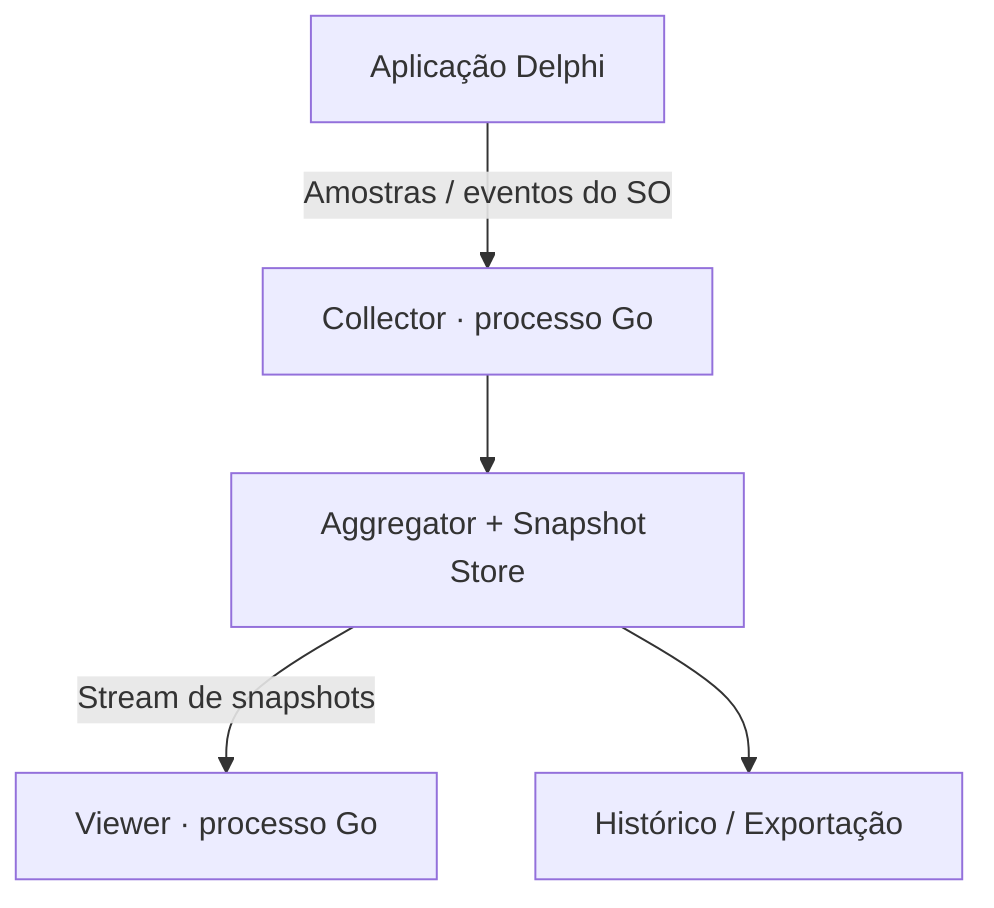

# Especificação técnica — Profiler de desempenho para aplicações Delphi desenvolvido em Go

**Versão:** 1.0 — documento inicial para implementação assistida por Codex  
**Data:** 13 de novembro de 2026  
**Estado:** proposta arquitetural para implementação incremental  
**Nome do produto:** a definir (o nome **GoProfiler** é somente ilustrativo)

> **Instrução principal ao Codex:** este documento define o produto, os valores de engenharia e a direção arquitetural. Não interprete sugestões de tecnologias como decisões irreversíveis. Comece pelos contratos, pelas provas de viabilidade e por incrementos pequenos e testáveis. Documente limitações e não apresente estimativas como medições reais.

---

## 1. Visão e motivação

Queremos construir uma **ferramenta de monitoramento e diagnóstico de performance em tempo real para aplicações desktop Delphi no Windows**, com a implementação principal em **Go**. O ponto de partida conceitual é o projeto open source [Hoshoyo/AntiPessimizer](https://github.com/Hoshoyo/AntiPessimizer), que identifica gargalos em procedimentos Delphi utilizando símbolos de depuração e instrumentação dinâmica.

O objetivo não é copiar cegamente o AntiPessimizer. Queremos preservar seu valor principal — **localizar procedimentos que concentram custos de execução** — e evoluir sua arquitetura para privilegiar:

- monitoramento contínuo, com baixo impacto na aplicação;
- processo de coleta independente da interface;
- snapshots estruturados, versionados e consultáveis;
- análise de desempenho ao longo do tempo, por procedimento, módulo e thread, quando houver informação suficiente;
- possibilidade de investigar tanto uma execução atual quanto sessões anteriores;
- extensibilidade sem acoplamento entre mecanismo de coleta e consumidores de dados;
- qualidade de código e testabilidade como propriedades essenciais, não etapas opcionais.

**Cenário de referência:** um grande aplicativo Win64 em Delphi, com VCL, inúmeros managers/controllers, múltiplas threads e grande volume de procedimentos, como uma plataforma desktop de mercado financeiro. A ferramenta deve ser genérica e não depender de código, infraestrutura ou bibliotecas proprietárias de uma aplicação específica.

### 1.1. Perguntas que o produto deve responder

1. Quais procedimentos ou módulos estão concentrando atividade de CPU no período selecionado?
2. Quais threads estão mais ativas e em quais procedimentos?
3. O que mudou nos últimos segundos/minutos? Surgiu um novo gargalo?
4. O mesmo procedimento piorou ou melhorou em relação a uma janela anterior?
5. Uma mudança de código melhorou ou piorou o desempenho entre duas sessões comparáveis?
6. Quais resultados são diretamente medidos e quais são estimativas estatísticas?

**Importante:** o profiler é uma ferramenta de **diagnóstico**; não otimiza automaticamente o executável Delphi nem diminui o tempo de compilação.

## 2. Valores inegociáveis do projeto

### 2.1. Qualidade de código como valor central

**A qualidade do código é um dos principais valores deste projeto.** Boas práticas idiomáticas de Go, testes automatizados, clareza arquitetural e facilidade de manutenção são critérios de aceitação de qualquer funcionalidade.

Princípios obrigatórios:

- **Simplicidade e legibilidade:** preferir soluções explícitas, pequenas e compreensíveis a abstrações genéricas prematuras.
- **Go idiomático:** composição, packages coesos, erros explícitos, contratos enxutos e interfaces definidas onde são consumidas, quando realmente agregam valor.
- **Baixo acoplamento e alta coesão:** separar plataforma Windows, domínio das métricas, mecanismos de coleta, agregação, transporte, armazenamento e apresentação.
- **Testabilidade desde o desenho:** dependências externas atrás de fronteiras substituíveis; relógio, processo-alvo e fontes de amostras devem poder ser simulados em testes.
- **Determinismo:** testes reproduzíveis, sem depender do Profit, de diretórios pessoais ou de processos arbitrários da máquina do desenvolvedor.
- **Concorrência segura:** ownership claro dos dados, cancelamento com `context.Context`, encerramento limpo de goroutines, ausência de data races e backpressure explícito.
- **Performance mensurável:** toda otimização deve partir de benchmark ou profiling; evitar micro-otimização especulativa.
- **Observabilidade interna:** erros, perdas, latência e overhead da própria ferramenta precisam ser monitoráveis.
- **Documentação útil:** README executável, ADRs para decisões relevantes, contratos de protocolo e comentários que expliquem decisões não óbvias.

### 2.2. Antipadrões a evitar

- `package utils`, `helpers` ou `common` como depósitos de responsabilidades sem relação;
- criar interfaces para cada struct/service sem necessidade de desacoplamento;
- aplicar Clean Architecture/DDD como cerimônia: preservar os limites conceituais sem multiplicar camadas vazias;
- singletons e estado global mutável para sessão, configuração ou resultados;
- goroutines sem owner, sem cancelamento ou com canais que podem bloquear indefinidamente;
- ignorar erros, usar `panic` para falhas esperadas ou fazer retry infinito;
- enviar eventos de cada chamada de procedimento individualmente à UI;
- permitir que widgets façam chamadas diretas de debugging, manipulação de memória ou leitura TD32;
- usar uma chamada de IA para suprir contratos e testes que deveriam existir no software;
- acoplar métricas de amostragem a definições de instrumentação exata.

## 3. Decisões e restrições atuais

| Aspecto | Direção acordada/proposta |
|---|---|
| Linguagem do projeto | Go, preferencialmente com código-fonte próprio escrito integralmente em Go |
| Sistema operacional inicial | Windows x64 |
| Processo monitorado | Aplicação desktop Delphi já compilada |
| Coletor | Processo independente do visualizador |
| Interface | Consumidora de snapshots; não coleta dados do processo-alvo |
| Atualização | Contínua, próxima de tempo real, sem redesenho a cada evento bruto |
| Contratos | Estruturados, versionados e independentes da tecnologia de UI |
| Histórico | Janelas temporais durante a sessão; exportação/comparação em evolução posterior |
| Coleta inicial recomendada | Amostragem externa, para validar um modo de baixo overhead |
| Instrumentação exata | Capacidade futura e opcional, sujeita a prova de viabilidade |
| MCP/IA | **Fora do escopo atual.** Apenas preservar a separação entre dados e consumidores |

### 3.1. Distinção técnica fundamental

**Coletor separado não significa necessariamente instrumentação 100% externa.** Existem dois modos distintos:

1. **Amostragem externa:** um processo Go observa atividade de CPU, threads, endereços e, quando possível, pilhas de chamadas. Não precisa necessariamente inserir hooks no Delphi. É a recomendação inicial para monitoramento prolongado.
2. **Instrumentação:** captura cada entrada/saída de procedimentos selecionados para obter contagens e durações mais precisas. Mesmo que o controlador e a UI sejam processos Go independentes, um mecanismo leve de medição precisará executar **no contexto do processo Delphi** (por código inserido/injetado, patches ou mecanismo equivalente). A implementação é consideravelmente mais invasiva.

Não reportar **contagem exata de chamadas**, **tempo por chamada**, **tempo inclusivo/exclusivo** ou **p95** caso o coletor não tenha os dados necessários. O modelo de domínio deve explicitar o método de coleta e a qualidade/limitação de cada métrica.

**Decisão provisória a validar na Fase 0:** iniciar com amostragem externa; manter um ponto de extensão para instrumentação focalizada posterior. Não implementar hooks ou DLL injetada como requisito do MVP sem prova técnica específica.

## 4. Arquitetura de alto nível



O diagrama é lógico: o Aggregator e o Snapshot Store podem inicialmente residir no mesmo processo do Collector, em módulos independentes. **Não criar um serviço distribuído ou vários executáveis apenas para reproduzir caixas de um diagrama.** Os executáveis mínimos são:

- `profiler-collector.exe`: anexa/observa o processo Delphi, transforma dados coletados em métricas, mantém a janela histórica e publica snapshots.
- `profiler-viewer.exe`: conecta ao collector, exibe o estado ao vivo e permite investigar históricos; se não houver collector, apresenta um estado desconectado claro.

Separação de responsabilidades:

| Componente | Responsabilidade | Não deve fazer |
|---|---|---|
| Target discovery | Enumerar, identificar e validar processos/módulos | Renderizar UI |
| Symbol resolver | Mapear endereço → módulo/procedimento, com indicação de confiança | Alterar métricas coletadas |
| Sampling collector | Obter observações de CPU/threads/stack por mecanismo Windows | Formatar gráficos |
| Aggregator | Agrupar observações em janelas, calcular deltas e hotspots | Conhecer widgets |
| Snapshot Store | Reter snapshots limitados por tempo/memória, permitir consultas | Interferir no processo Delphi |
| Transport | Publicar snapshots e receber comandos de sessão | Ser fonte de verdade das métricas |
| Viewer/UI | Exibir, filtrar, ordenar e comparar dados publicados | Chamar APIs de debugging ou manipular memória |

### 4.1. Fonte única da verdade

O **collector é autoritativo para os dados medidos**. A UI pode calcular apresentações derivadas, mas não reinterpreta a semântica de coleta. O viewer nunca deve assumir que chegou todo snapshot: desconexões e sobrecarga são condições previstas.

Se mais tarde houver outro consumidor (CLI, exportador, ferramentas externas), ele deve consumir o mesmo contrato, não acessar internamente a UI.

### 4.2. Transporte inicial

Preferir comunicação **local** entre processos Windows. Named Pipes são uma escolha natural; testar uma prova de conceito antes de fixar a tecnologia. Outra opção é HTTP local + SSE/WebSocket, caso haja necessidade clara. Não abrir porta externa por padrão.

Contrato lógico mínimo, independente de transporte:

- `StartSession(processID, options)`;
- `StopSession(sessionID)`;
- `GetSessionStatus(sessionID)`;
- `GetLatestSnapshot(sessionID)`;
- `SubscribeSnapshots(sessionID)`;
- `GetHistory(sessionID, timeRange, filters)`;
- `ListProcesses()`.

Essas operações são **contratos propostos**, não endpoints a implementar simultaneamente. Comandos mutáveis ficam no controlador; consulta é leitura. O protocolo deve possuir versionamento e erros estruturados.

## 5. Modelo de snapshots e semântica das métricas

### 5.1. O que é um snapshot

Um snapshot é uma visão **imutável, consistente e identificável de um intervalo de coleta**, calculada e publicada periodicamente. Não é um dump bruto de todos os eventos. Deve conter:

- `schema_version`;
- identificadores de sessão e processo (PID e início do processo, para distinguir reutilização de PID);
- `sequence` monotonicamente crescente na sessão;
- `window_start`, `window_end` e timestamp de publicação, em UTC;
- modo de coleta (`sampling` ou `instrumentation`);
- contadores de integridade, perda e atrasos da coleta;
- estatísticas globais e métricas por módulo/procedimento/thread;
- metadados de resolução de símbolos (resolvido/parcial/desconhecido);
- unidades e definição de cada métrica.

**Não confundir janela e acumulado:** todos os campos numéricos precisam indicar se são relativos à janela corrente ou ao acumulado da sessão. Métricas de CPU amostrado são **estimativas**. Tempos somados entre threads não são automaticamente tempo de relógio nem porcentagem direta de CPU.

### 5.2. Exemplo ilustrativo do contrato

```json
{
  "schema_version": 1,
  "session_id": "session-uuid",
  "sequence": 42,
  "target": {
    "pid": 12840,
    "process_start_utc": "2026-11-13T14:00:00Z",
    "image_name": "AplicacaoDelphi.exe"
  },
  "collection_mode": "sampling",
  "window_start_utc": "2026-11-13T14:01:00.000Z",
  "window_end_utc": "2026-11-13T14:01:00.250Z",
  "published_at_utc": "2026-11-13T14:01:00.267Z",
  "quality": {
    "samples_observed": 1500,
    "samples_lost": 0,
    "symbol_resolution": "partial"
  },
  "hotspots": [
    {
      "symbol_id": "module+relative-address",
      "module": "AplicacaoDelphi.exe",
      "procedure": "TExample.Calculate",
      "thread_id": 3180,
      "sample_count": 250,
      "estimated_cpu_share_in_window": 0.1667,
      "symbol_status": "resolved"
    }
  ]
}
```

**Dados fictícios e contrato preliminar.** `estimated_cpu_share_in_window` exige definição exata de denominador e metodologia antes da implementação. A equipe deve escrever essa definição no contrato definitivo. É aceitável removê-lo do MVP e começar por contagens de amostras, mais transparentes.

### 5.3. Regras de consistência

- `sequence` incrementa a cada snapshot publicado; não é obrigatório renderizar todos na UI.
- Janelas temporais identificadas não podem se sobrepor inadvertidamente ao calcular métricas por segundo.
- Reinício de collector cria outra sessão ou utiliza protocolo explícito de recuperação; não reutilizar sequência de sessão anterior silenciosamente.
- Os identificadores de procedimento devem permanecer estáveis dentro da sessão e evitar depender exclusivamente de endereços absolutos sujeitos a ASLR.
- Procedimento desconhecido não é erro fatal: publicar endereço, módulo, motivo e status de resolução.
- Se o consumidor estiver lento, **descartar/coalescer atualizações de exibição** é permitido; falsificar contadores ou descartar silenciosamente dados necessários para agregação não é.
- Contadores de dados perdidos e atraso de publicação devem ser expostos.

### 5.4. Histórico e reavaliação contínua

O Aggregator deve manter janelas recentes e permitir:

- comparação da janela atual com as anteriores;
- ranking por intensidade de atividade nas últimas `1s`, `10s`, `30s` ou intervalo selecionado (configurável);
- identificação de **novos hotspots** e alterações relevantes de ranking;
- consulta por módulo/procedimento/thread;
- retenção em memória com limite de idade e volume;
- exportação futura para análise entre sessões.

Mudanças aparentes devem ser apresentadas como **variações observadas**, com sinalização de insuficiência de amostras quando aplicável. Não inferir regressão causal sem contexto/comparabilidade entre execuções.

## 6. Mecanismo de coleta e descoberta de símbolos

### 6.1. Coleta externa inicial

Investigar uso das APIs de **Event Tracing for Windows (ETW)** e amostragem de CPU como mecanismo de baixo overhead. A documentação Microsoft confirma que ETW permite consumo em tempo real e que sampling tende a ter overhead menor que instrumentação por chamadas. Referências:

- [Microsoft — About Event Tracing](https://learn.microsoft.com/en-us/windows/win32/etw/about-event-tracing)
- [Microsoft — Understand profiler performance collection methods](https://learn.microsoft.com/en-us/visualstudio/profiling/understanding-performance-collection-methods-perf-profiler)

**Não presumir que integrar ETW em Go é trivial.** Validar permissões, coleta por processo, fidelidade da identificação de threads, disponibilidade de stacks, latência, perda de eventos e custo da simbolização.

Uma estratégia experimental de `SuspendThread` + `GetThreadContext` não deve ser adotada automaticamente para monitoramento contínuo: suspender threads arbitrariamente pode perturbar o próprio programa e introduzir risco de deadlock/viés. Preferir mecanismo robusto de sampling do sistema após prova técnica.

### 6.2. Símbolos Delphi

O AntiPessimizer usa componentes da **JEDI Code Library (JCL)**, especialmente `JclTD32`, `JclDebug` e `JclPeImage`, para correlacionar procedimentos com endereços.

No novo projeto:

1. usar `debug/pe` e APIs Windows para leitura de imagens PE e módulos;
2. investigar como extrair/interpretar informações Delphi **TD32** presentes no cenário-alvo;
3. implementar um parser **mínimo, isolado e testado** para o subconjunto necessário, se nenhuma biblioteca Go apropriada atender;
4. permitir fallback para identificação por `módulo + endereço relativo` quando não houver símbolos;
5. registrar versão/assinatura do executável e origem dos símbolos utilizados.

Não portar a JCL inteira. Trabalhar com fixtures binários pequenos, versões de Delphi explicitamente suportadas e testes para símbolos ausentes/corrompidos. `debug/pe` não substitui por si só um leitor TD32.

### 6.3. Instrumentação futura, não MVP

Se a necessidade de número exato de chamadas e tempos inclusivos/exclusivos justificar, planejar módulo isolado de instrumentação x64. Usar `golang.org/x/arch/x86/x86asm` como candidato a decodificador, mas reconhecer que **decodificação não implementa trampolines, relocação de instruções, patching, ABI, unwind ou isolamento de hooks**.

Exigir protótipo separado, análise de risco, testes contra executáveis de laboratório, controle de overhead e restauração segura. Não executar callbacks Go indiscriminadamente a cada chamada Delphi sem comprovar a segurança e o custo da interação com runtime Go. Modo instrumentado deve ser opt-in e claramente indicado na UI.

## 7. Interface gráfica: observabilidade em tempo real

### 7.1. Responsabilidade e tecnologia

O Viewer é uma aplicação independente. **Somente consome snapshots e faz consultas de leitura ao collector**. Não possui conhecimento de ETW, TD32, trampolines ou memory patching.

Tecnologia recomendada para avaliar primeiro: **Fyne**, pela interface desenvolvida em Go e `widget.Table` com reutilização de células. Verificar previamente seus requisitos de CGO e compilador C no build Windows. Se houver necessidade comprovada de gráficos ou UX não atendidos, registrar um ADR de migração para outra UI (por exemplo Wails, reconhecendo que o frontend deixaria de ser 100% Go).

### 7.2. Telas propostas

**Tela A — Live Profiler (prioridade máxima)**

- seleção de processo e estado da conexão;
- iniciar/parar sessão, indicador `LIVE`, duração e modo de coleta;
- indicadores: threads observadas, módulos/símbolos conhecidos, amostras/s, atraso de snapshot, perda de coleta, overhead estimado quando mensurável;
- gráfico temporal da atividade capturada;
- ranking de hotspots por janela selecionada;
- tabela virtualizada, filtro por texto/módulo/thread e ordenação estável;
- painel de detalhes ao selecionar um procedimento;
- sinalização visual de novo hotspot e alterações relevantes.

**Tela B — Threads**

- lista das threads do processo e atividade por janela;
- filtro por TID;
- procedimentos mais observados em cada thread;
- evolução temporal e indicação de informação insuficiente.

**Tela C — Histórico/Comparação (fase posterior)**

- seleção de duas janelas da mesma sessão ou duas sessões comparáveis;
- delta absoluto e relativo de métricas com mesma semântica;
- identificação de símbolos incluídos/removidos/não resolvidos;
- exportação de resultado e parâmetros de coleta utilizados.

**Não implementar flame graph/call tree verdadeira** até que a coleta forneça stacks/cadeias de chamada suficientes. Não reconstruir causalidade a partir de tempo agregado isolado.

### 7.3. Política de atualização

Parâmetros iniciais **propostos para benchmark**, configuráveis:

| Operação | Cadência inicial |
|---|---|
| Coleta de amostras | Configurada pelo mecanismo e pelos limites do Windows |
| Snapshot agregado | a cada 100–250 ms |
| Atualização de gráficos | 5–10 Hz |
| Atualização da tabela | 2–4 Hz |
| Resort completo | 500 ms ou sob interação |
| Histórico ao vivo | retenção configurável, com limite explícito |

Pontos obrigatórios:

- virtualização da tabela; não criar um widget por procedimento de toda a sessão;
- atualizar apenas dados visíveis/diferentes, evitar alocação e formatação excessiva;
- **não bloquear a thread de UI** com queries pesadas, serialização ou ordenação completa;
- snapshots imutáveis passados entre goroutines, sem compartilhamento inseguro;
- coalescência de updates sob carga; a UI pode pular frames, o collector não deve desacelerar;
- filtros e ordenação previsíveis enquanto dados mudam;
- mostrar estados de carregamento, desconectado, target finalizado e símbolos indisponíveis.

## 8. Requisitos não funcionais e resiliência

### 8.1. Desempenho

- A ferramenta deve medir e divulgar seu próprio overhead em um benchmark controlado.
- O objetivo é **menor impacto possível no processo-alvo**; não anunciar overhead de 1%, 2% etc. sem medição.
- Estabelecer, durante a Fase 0/1, um orçamento reproduzível de CPU, memória, latência e perda; os limites definitivos dependem do hardware e cenário de referência.
- Em testes de estresse, aumentar a quantidade de módulos, threads, símbolos, amostras/s e consumidores lentos.
- O uso de memória deve permanecer limitado mesmo em sessões longas, com política explícita de retenção.
- Snapshot completo muito volumoso deve poder ser substituído por consultas paginadas/top-N e deltas incrementais, preservando consistência e versionamento.

### 8.2. Tolerância a falhas

- Se a UI fechar, o collector deve continuar ou encerrar conforme a política explícita da sessão, **sem depender de widgets**.
- Se o collector morrer, a UI deve sinalizar desconexão e permitir reconexão quando suportada.
- Se o target terminar, encerrar coleta ordenadamente e preservar resultados já consistentes.
- Se não houver símbolos, continuar a coleta e representar endereços não resolvidos.
- Se a origem perder dados, indicar perda e impacto na interpretação do período.
- Se a fila de transporte saturar, aplicar política de backpressure/coalescência definida; nunca deixar memória crescer indefinidamente.
- Todas as goroutines devem ser encerráveis e testes devem verificar que não há vazamento.

### 8.3. Segurança e privacidade

- Ferramenta **local-first**, sem telemetria externa e sem transmitir métricas para servidores por padrão.
- Restringir Named Pipes/transportes ao usuário local autorizado; não expor API de controle na rede sem autenticação explícita.
- Aplicar princípio do menor privilégio; solicitar elevação somente se o mecanismo escolhido realmente precisar.
- Anexar apenas a processos selecionados conscientemente pelo usuário.
- Não alterar arquivos/binários do target. Qualquer futura modificação de memória requer modo opt-in, critérios de compatibilidade e recuperação segura.
- Não exportar automaticamente caminhos sensíveis, tokens, memória arbitrária ou conteúdo de dados de negócio.

## 9. Organização inicial sugerida do repositório

Proposta enxuta — ajustar conforme responsabilidades reais surgirem:

```text
cmd/
  collector/
    main.go
  viewer/
    main.go

internal/
  session/           # Ciclo de vida e estado de sessão
  profiling/         # Modelos e semântica das métricas
  sampling/          # Abstração de observações e coleta
  aggregation/       # Janelas, rankings e snapshots
  symbols/           # Endereço -> símbolo e resolução
    td32/            # Leitor TD32, se necessário
  platform/
    windows/         # WinAPI / integração específica Windows
  transport/         # Protocolos de comunicação locais
  history/           # Retenção, consultas e exportação
  ui/                # Apresentação: apenas contratos e snapshots

docs/
  adr/
  architecture.md
  metrics.md
  protocol.md
  performance.md

testdata/
  symbols/
  snapshots/
```

Regras de dependência:

- `profiling`, `aggregation` e `session` devem ter pouco ou nenhum acoplamento com Windows/GUI;
- `sampling` descreve o contrato da fonte, com implementação Windows isolada;
- `ui` depende do contrato de snapshots, não de `platform/windows`;
- `cmd` compõe implementações concretas;
- evitar dependências cíclicas e packages genéricos;
- usar interfaces pequenas nas fronteiras de I/O, tempo e processos, sem abstração artificial de cada serviço.

## 10. Estratégia de testes — requisito obrigatório

**Nenhum marco funcional é considerado concluído sem os testes correspondentes.** Preferir `testing` da biblioteca padrão de Go, testes table-driven e fakes/stubs mínimos. Bibliotecas adicionais só quando houver benefício concreto.

### 10.1. Testes unitários

| Componente | Casos mínimos |
|---|---|
| Cálculo de janelas | fronteiras temporais, janelas vazias, timestamp fora de ordem, clock simulado |
| Aggregator | contagens, top-N, filtros, combinação por procedimento/thread, overflow de contadores |
| Snapshots | sequência, imutabilidade, versionamento, metadados e qualidade da amostra |
| Histórico | retenção por tempo/capacidade, descarte determinístico, consultas por intervalo |
| Transporte | serialização, versão incompatível, cancelamento, cliente lento/desconectado |
| Symbol resolver | endereço válido, deslocamento, ausência, conflitos, arquivo corrompido |
| Orquestração | start/stop, falha parcial, reinício, término do processo-alvo, timeout |

### 10.2. Integração e ponta a ponta

- Fake Collector produz snapshots determinísticos; Viewer os consome **sem processo Delphi real**.
- Collector real observa um **executável de laboratório** pequeno e controlado (quando o ambiente Windows estiver disponível).
- Testar desligamento de UI, perda de conexão e reinicialização do collector.
- Testar símbolo resolvido e não resolvido.
- Testar múltiplos processos/threads conforme suporte declarado.
- Realizar teste de longa duração para confirmar memória limitada e ausência de vazamentos.
- Usar somente ambientes/testes explicitamente controlados; nunca automatizar attach ao Profit de produção.

### 10.3. Concorrência e desempenho

- Executar `go test ./...` no CI.
- Executar testes com `-race` nos ambientes suportados; em Windows, preparar toolchain CGO quando necessário.
- Criar benchmarks `go test -bench` para agregação, serialização, filtragem, símbolos e top-N.
- Registrar perfis CPU/memória do próprio collector com `pprof` quando útil.
- Repetir benchmarks com e sem profiler no processo-alvo em cenários representativos.
- Medir latência p50/p95 de publicação/visualização, uso de CPU/memória e perdas sob carga.
- Não aceitar otimização baseada apenas em impressão visual da UI.

### 10.4. Qualidade e revisão

Padrão mínimo antes de integrar uma mudança:

1. código formatado com `gofmt`;
2. `go vet ./...` sem problemas relevantes;
3. suíte de testes adequada passando;
4. testes de concorrência quando envolvidos channels, goroutines ou estado compartilhado;
5. novos comportamentos acompanhados por testes e documentação de limitações;
6. benchmarks comparativos para mudanças declaradas como otimização;
7. revisão de API, responsabilidades e simplicidade do código;
8. ausência de hardcodes de caminhos pessoais, segredos e dependências de ambiente no domínio.

Não sacrificar qualidade para acelerar entrega. Se um requisito for tecnicamente difícil, reduzir o escopo do incremento, criar um spike e documentar a descoberta.

## 11. Roadmap incremental sugerido

### Fase 0 — Pesquisa e provas técnicas

**Entregáveis:** ADRs curtos e provas reproduzíveis, sem compromisso com UI final.

- confirmar matriz alvo Delphi/Windows x64;
- validar um método de sampling externo em Go e permissões necessárias;
- inspecionar disponibilidade de stacks e endereços/módulos por thread;
- comprovar pelo menos uma estratégia de simbolização real com binário Delphi de laboratório;
- medir custo mínimo do mecanismo escolhido;
- escolher e congelar o contrato inicial de snapshots;
- registrar decisão de transporte local e de UI com prós/contras.

**Critério de saída:** evidência de que conseguimos coletar pelo menos dados reais de atividade do processo, com latência e impacto mensurados; limitações de TD32 documentadas. Se uma hipótese falhar, não esconder a falha: propor alternativa e reavaliar.

### Fase 1 — Núcleo Go independente da UI

- modelos de sessão, observações, janela e snapshot;
- agregador determinístico com testes;
- histórico bounded in-memory;
- Fake Collector para gerar carga controlada;
- serialização versionada e teste de compatibilidade.

**Critério de saída:** snapshots consistentes emitidos a partir de carga sintética; testes unitários e benchmarks básicos passando.

### Fase 2 — Processo collector e transporte

- implementar ciclo de vida e comandos mínimos;
- conectar origem real já validada;
- publicar snapshots em stream local;
- tratar cancelamento, desconexão, término do target, perda e limites de memória;
- telemetria mínima da própria ferramenta.

**Critério de saída:** collector independente observado por cliente de testes/CLI, sem UI.

### Fase 3 — Viewer em tempo real

- interface Fyne inicial ou tecnologia escolhida no ADR;
- lista de processos, sessão e status;
- tabela virtualizada de hotspots e filtro por thread/procedimento;
- gráfico temporal e painel de detalhes;
- reconexão e coalescência de snapshots;
- medir custo de renderização com dados sintéticos volumosos.

**Critério de saída:** UI responsiva, dados reais quando disponíveis, sem acoplar coleta aos widgets.

### Fase 4 — Simbolização Delphi e diagnóstico aprofundado

- aprimorar parser e cobertura TD32 conforme fixtures reais;
- melhorar associação módulo/procedimento/thread;
- filtros, evolução e comparação entre janelas;
- registrar confiabilidade estatística e lacunas de informação.

**Critério de saída:** identificação útil de hotspots em aplicação Delphi de laboratório; símbolos ausentes tratados corretamente.

### Fase 5 — Histórico persistente e comparação

- formato de sessão versionado e exportação;
- comparação de duas sessões sob premissas compatíveis;
- relatórios de deltas e regressões potenciais;
- testes de migração e compatibilidade de arquivos.

### Futuro, não autorizado para o MVP

- instrumentação de entrada/saída de procedimentos e tempos exatos;
- call graph/flame graph se houver stacks ou rastreamento suficiente;
- integração com IA/MCP;
- diagnósticos automatizados ou sugestões de alteração de código;
- coleta remota, múltiplas máquinas ou serviço centralizado.

## 12. Critérios de aceite globais

Um MVP de monitoramento será considerado funcional quando:

- [ ] o collector e o viewer rodarem como processos separados;
- [ ] for possível selecionar e monitorar uma aplicação Delphi de laboratório;
- [ ] snapshots forem produzidos em cadência configurável e com sequência/tempo versionados;
- [ ] a UI exibir atividade e hotspots em tempo real, com indicação da modalidade de coleta;
- [ ] desconexões ou término do processo não travarem a UI;
- [ ] houver métricas de qualidade da coleta, inclusive perdas;
- [ ] o histórico em memória tiver limite explícito e puder ser consultado por janela;
- [ ] símbolos ausentes forem reportados corretamente, sem resultados falsos;
- [ ] testes de domínio, protocolos e concorrência estiverem automatizados;
- [ ] benchmarks documentarem overhead e latência em ambiente definido;
- [ ] nenhum componente de UI executar diretamente operações de coleta;
- [ ] README, limitações conhecidas e decisões arquiteturais estiverem atualizados.

Não exigir que a primeira versão possua nomes de todos os procedimentos Delphi caso a prova TD32 ainda não esteja concluída. Nesse caso, a UI deve exibir módulos/endereços com semântica correta e a limitação deve ficar explícita.

## 13. Instruções operacionais ao Codex

**Objetivo da primeira interação:** analisar esta especificação e propor um plano de implementação que respeite o roadmap, sem tentar construir todo o produto em uma única alteração.

1. Inspecione o repositório e seus `AGENTS.md`/convenções antes de propor mudanças; preserve alterações existentes.
2. Consulte o AntiPessimizer **como referência de comportamento**, especialmente seu README e a separação entre GUI C++, DLL Delphi, JCL/TD32, Udis86 e named pipe. Não copie o mecanismo de instrumentação sem avaliar as restrições atuais.
3. Identifique riscos e decisões técnicas ainda em aberto; escreva ADRs curtos para coleta externa, formato de snapshot, comunicação local e UI.
4. Proponha a organização mais simples de packages que sustente os limites arquiteturais. Não aplique Clean Architecture de forma dogmática.
5. Priorize **Fase 0** e depois **Fase 1**. Traga resultados mensuráveis e testes em cada incremento.
6. Escreva testes junto da implementação e use fakes/stubs apropriados. Testes não podem exigir um processo proprietário em execução.
7. Diferencie sempre fatos medidos, estimativas, hipóteses e funcionalidades futuras.
8. Se o ambiente não for Windows ou faltar toolchain/Delphi para integração, não simule sucesso de testes Windows: execute os testes portáveis, documente bloqueios e entregue instruções reproduzíveis de validação no Windows.
9. Evite adicionar dependências, goroutines e abstrações sem necessidade; justifique decisões que afetem desempenho ou manutenção.
10. Antes de declarar um marco concluído, apresente testes executados, resultados, limitações, benchmarks disponíveis e próximos passos.

### 13.1. Primeira entrega recomendada

Uma base Go mínima com:

- `go.mod` e README;
- tipos de domínio para sessão, amostra e snapshot;
- contrato de coleta substituível e Fake Collector;
- agregador com janela temporal e testes table-driven;
- um cliente mínimo (CLI ou teste de integração) consumindo snapshots falsos por stream;
- benchmark inicial do agregador;
- ADR de estratégia de coleta Windows, contendo plano de validação real.

**Não começar pela construção de uma UI visualmente completa.** Primeiro garantir que os dados, a semântica das métricas e o fluxo independente de snapshots são corretos. A interface depende dessa estabilidade.

## 14. Referências técnicas iniciais

- AntiPessimizer: https://github.com/Hoshoyo/AntiPessimizer
- Udis86 (desassemblador x86/x64): https://github.com/vmt/udis86
- JEDI Code Library / TD32: https://github.com/project-jedi/jcl
- Go x86 disassembler: https://pkg.go.dev/golang.org/x/arch/x86/x86asm
- Go Windows bindings: https://pkg.go.dev/golang.org/x/sys/windows
- Microsoft ETW: https://learn.microsoft.com/en-us/windows/win32/etw/about-event-tracing
- Microsoft, sampling vs instrumentation: https://learn.microsoft.com/en-us/visualstudio/profiling/understanding-performance-collection-methods-perf-profiler
- Fyne Table: https://docs.fyne.io/collection/table
- Fyne requisitos de build: https://docs.fyne.io/started/quick/

---

## Síntese da direção de engenharia

Construir um profiler **Go-first**, Windows x64, que observe aplicações Delphi e publique **snapshots estruturados, consistentes e contínuos**. O **collector é independente do viewer**; a interface mostra e consulta os dados sem conhecer a implementação da coleta. Começar com uma prova de amostragem externa de baixo overhead, validar símbolos Delphi e crescer por incrementos. Instrumentação exata e integrações externas ficam para depois. **Código limpo, testes, concorrência segura, desempenho mensurado e manutenção sustentável são requisitos fundamentais, não opcionais.**
